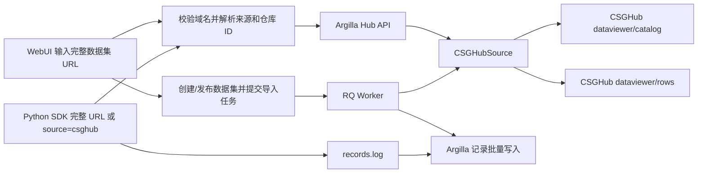

# 从 CSGHub 导入数据集

## 原有 Hugging Face 导入管线

WebUI 原来从 `ImportFromHub.vue` 接收仓库 ID，经过 `GetDatasetCreationUseCase`
和 `HubRepository` 请求 Argilla 的 `/api/v1/hub/datasets/*` 接口。服务端使用
自己的 HF Token 访问 `datasets-server.huggingface.co`，获得 subset、split、
features 和预览记录。`DatasetCreationBuilder` 根据 features 创建 Fields、
Questions 和 Metadata 的初始映射。

用户确认配置后，WebUI 创建数据集及其字段、问题，然后发布数据集，调用
`POST /api/v1/datasets/{id}/import`。后台 Redis/RQ worker 执行
`import_dataset_from_hub_job`，通过 `HubDataset` 流式读取指定 subset/split，
映射成 Argilla Record，并批量写入数据库与搜索索引。WebUI 导入保留原有的
**10,000 条上限**。

Python SDK 的 HF 路径原本独立执行：`Dataset.from_hub()` 读取仓库中的 Argilla
配置或调用 `Settings.from_hub()` 推断配置，再用 `datasets.load_dataset()`
读取记录，通过 `dataset.records.log()` 上传。`settings="ui"` 则生成 WebUI
配置链接。

## CSGHub 兼容方式



CSGHub 虽提供 HF 兼容仓库文件接口，但没有同地址的 HF Dataset Viewer 服务。
本实现使用 CSGHub 原生 DataViewer 接口，并把目录与行数据转换为 Argilla
现有导入协议。没有修改进程级 `HF_ENDPOINT`，也没有把 HF 凭据用于 CSGHub。
SDK 和 WebUI 共享服务端适配器，避免数据类型、分页和鉴权出现两套行为。

WebUI 的输入框现在必须填写完整的数据集页面 URL，例如：

```text
https://huggingface.co/datasets/stanfordnlp/imdb
http://127.0.0.1/datasets/root/example
```

`/api/v1/hub/datasets/resolve` 在访问上游之前识别来源：HF URL 必须属于
`https://huggingface.co`，CSGHub URL 必须匹配配置的 endpoint 的协议、主机、
端口和路径前缀。URL 必须以 `/datasets/namespace/name` 结束，不含登录信息、
查询参数或片段；`namespace/name` 裸 ID 会在 WebUI 中提示填写完整 URL。
首页示例卡片和 SDK 的旧式仓库 ID 调用保留兼容。

- `catalog.dataset_info[]` 转换为按配置名组织的 `dataset_info`，保留所有 split。
- `columns`、`columns_type`、二维 `rows` 转换为命名列、features 和原生记录值。
- CSGHub Parquet 预览可能把数值或布尔值序列化为字符串，例如 `INT64` 列返回
  `"0"`。适配器依据声明的列类型还原标量，确保 SDK 和 worker 写入的值与
  metadata 类型一致；文本列中的 `"001"` 不会被转换，非法数值会明确报错。
- 原生列表、对象、换行和空值不被拼接或扁平化；字段映射仍由用户确认。
- 分页转换处理非整页 offset、跨页和最后一页；后台导入按批读取。
- CSGHub 没有对应的列统计接口，因此不生成虚假的统计结果。
- CSGHub 使用 Argilla 同源 iframe 预览页 `/dataset-viewer/csghub`，通过已有
  Hub API 读取原生 DataViewer 数据。表格支持分页、横向滚动和长文本展开，
  显示当前 subset/split 以及总记录数，跟随 Fields 中的 subset/split 切换。
  该页面不是嵌入整个 CSGHub Portal，不要求浏览器另行登录 CSGHub；iframe
  URL 仅包含仓库、subset 和 split，访问令牌留在服务端。请求失败时隐藏旧
  表格并显示重试入口，数据中的 HTML 作为文本显示，不会被执行。
- 页面来源写入数据集 metadata，生成的继续上传示例也保持 CSGHub 来源。

## 配置

在 Argilla **server 和 worker** 上设置相同配置，例如在
`deploy/github-dev/.env` 中添加：

```dotenv
ARGILLA_CSGHUB_ENDPOINT=http://127.0.0.1
ARGILLA_CSGHUB_TOKEN=你的CSGHub用户访问令牌
```

Endpoint 使用站点根地址，不追加 `/api/v1` 或 `/hf`。
令牌应属于具有目标仓库读取权限的 CSGHub 用户；Portal 内部的系统 API Key
不能替代用户访问令牌。私有仓库的访问范围由该令牌决定。WebUI 不传递任意
endpoint 或 token，Argilla 的 Hub 访问角色策略仍生效。

如果 Argilla 在 Docker 中、CSGHub 暴露在宿主机的 80 端口，还需：

```dotenv
ARGILLA_CSGHUB_INTERNAL_ENDPOINT=http://host.docker.internal
```

Compose 为 server 和 worker 配置了 `host.docker.internal:host-gateway`。
浏览器 URL 仍匹配 `ARGILLA_CSGHUB_ENDPOINT`，服务端和 worker 连接内部地址。
直接在宿主机启动 Python 服务测试时应留空内部地址，使其访问 `127.0.0.1`。
容器内的 `127.0.0.1` 是该容器自身，不能直接用它连接宿主机 CSGHub。

更改配置后同时更新 server 和 worker。该功能需要本分支的服务端、前端和 SDK，
现有官方镜像不包含这些修改。

### 本机真实实例验证

2026-10-27 使用本机 CSGHub 的私有仓库 `root/argilla-imdb-import-test`
验证了用户 access token：未提供或无效 token 返回 401，正确 token 可读取
DataViewer。样本取自本地缓存的 `stanfordnlp/imdb` test split，共 205 条，
通过 CSGHub 的 multipart `upload_file` 接口上传 Parquet 文件并生成预览。

- 修改后的 SDK 使用完整 URL 和 `settings="auto"`，跨页导入前 105 条记录。
- Chrome WebUI 使用相同 URL，完成预览、配置和 worker 导入全部 205 条。
- 两条路径的文本和整数标签均逐条回读，与原始 Parquet 样本一致。

这些测试运行于隔离的 Argilla 源码实例（前端 16900、API 16901），没有更新
现有 6900 容器。仅修改 `.env` 不会让旧镜像获得本分支的新功能。

## WebUI 使用

1. 展开首页的 Import from Hub。
2. 输入完整数据集 URL；页面根据域名自动识别 Hugging Face 或 CSGHub。
3. 选择 subset、split，检查 Fields、Metadata 并添加至少一个必填问题。
4. 选择目标工作区并导入，通过原有后台任务跟踪进度。

## SDK 使用

SDK 只需 Argilla 凭据；CSGHub 凭据由上述服务端配置管理。

```python
import os
import argilla as rg

client = rg.Argilla(
    api_url="http://127.0.0.1:6900",
    api_key=os.environ["ARGILLA_API_KEY"],
)

dataset = rg.Dataset.from_hub(
    "http://127.0.0.1/datasets/namespace/dataset",
    name="imported-from-csghub",
    workspace="admin",
    client=client,
    subset="default",
    split="train",
    settings="auto",
    max_records=1000,
)
```

完整 URL 会自动识别来源；SDK 也保留 `repo_id="namespace/dataset", source="csghub"`
的写法。HF 同样可传入 `https://huggingface.co/datasets/namespace/dataset`，或使用
原有的 `namespace/dataset`。完整 URL 的解析需要本分支的 Argilla server。

`max_records` 是 SDK 的可选上限；省略时按页读取整个 split。`with_records=False`
只创建配置。也可传入显式 `rg.Settings`；`Settings.from_hub(..., source="csghub",
client=client)` 用于先检查、调整映射。`settings="ui"` 的链接保留来源、subset
和 split，不包含访问令牌。

向已有数据集继续上传：

```python
dataset = client.datasets(name="existing-dataset", workspace="admin")
for rows in client.api.hub.iter_batches(
    "namespace/dataset", "default", "train", source="csghub", max_records=1000
):
    dataset.records.log(rows)
```

## 边界与错误

当前兼容的是 **CSGHub DataViewer 可读取的数据集**。请先在 CSGHub 完成数据
预览准备；只有仓库名称、尚未同步文件或尚未生成预览的仓库会明确报错，而不会
创建一个“导入成功但零条记录”的假结果。此路径不解析原始仓库中的 Argilla
导出配置文件，也不扩展 `to_hub()` 的导出目的地。

仓库不存在、令牌缺失/权限不足、预览未就绪、连接超时和响应结构异常分别作为
错误处理。列类型优先使用 DataViewer 类型信息，复杂列参考样本识别；无法可靠
识别的字段需要手动映射，不能从 0/1 数值推断业务含义。

`settings="auto"` 复用 SDK 原来的类型推断：文本和聊天列可生成字段，数值列通常
生成元数据。仅有数值或无法识别的复杂列时，需要显式配置 `Settings`；不会把所有
列强行转换成文本。WebUI 保留已有的原生 JSON 自定义字段映射。

## 验证范围

已用符合本仓库 CSGHub DataViewer 响应结构的测试源进行隔离验证：

- 服务端 API 鉴权、凭据隔离、错误响应、跨页读取，以及后台任务的来源参数。
- 完整 URL 的来源识别、裸 ID 拒绝、伪造 HF 域名与非配置端口拒绝、容器内外地址区分。
- SQLite 中 205 条记录的字段重命名、嵌套对象、换行、数值元数据和重试去重。
- 真实 Argilla server、RQ worker、Redis、Elasticsearch 上，SDK 和 Chrome WebUI
  各导入 205 条记录，并回读核对所有文本和元数据；WebUI 标注页显示 205 条。
- SDK 生成的 CSGHub 链接能够选中 `chat/test` 子集和 split，预览不请求 HF iframe。

这些结果验证的是适配协议和 Argilla 内部链路，不替代目标 CSGHub 实例的联调。
目标实例需要可访问、DataViewer 已就绪，并配置有读取权限的用户令牌。
